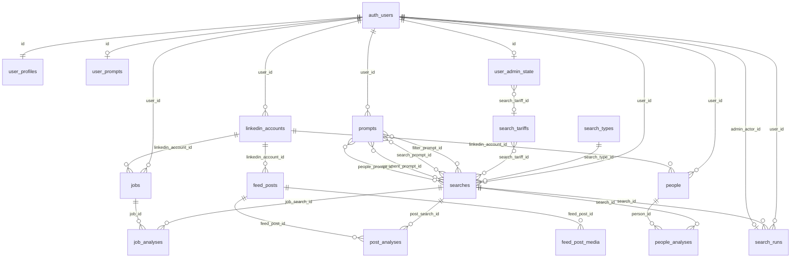

# Связи таблиц Pulse Reader (поля → FK)

Справочник **какие колонки связывают какие таблицы** (внешние ключи и логические цепочки для RLS).  
Описание назначения таблиц — в [`DB_SCHEMA_RU.md`](./DB_SCHEMA_RU.md). Источник правды — `worker/supabase/migrations/*.sql` (актуально после всех применённых миграций).

## Условные обозначения

| `ON DELETE` | Смысл |
|-------------|--------|
| **CASCADE** | При удалении родителя удаляются дочерние строки |
| **SET NULL** | При удалении родителя в дочерней колонке ставится `NULL` |
| **RESTRICT** | Нельзя удалить родителя, пока есть ссылки (только у `search_types`) |

Удалённые схемы: `job_searches`, `post_searches` — заменены таблицей `searches` (миграция `20260924213000_unify_searches.sql`).

## Общая схема (после унификации поисков)

> Имена колонок `job_analyses.job_search_id` и `post_analyses.post_search_id` исторические: обе ссылаются на **`public.searches.id`**, а не на удалённые `job_searches` / `post_searches`.

## 1. Центр: `auth.users`

Все продуктовые данные пользователя в итоге «принадлежат» `auth.users.id` напрямую или через 1–2 промежуточные таблицы.

| Откуда (таблица.поле) | Куда (таблица.поле) | ON DELETE | Зачем |
|------------------------|---------------------|-----------|--------|
| `user_profiles.id` | `auth.users.id` | CASCADE | 1:1 профиль |
| `user_prompts.id` | `auth.users.id` | CASCADE | 1:1 legacy-промпты в ЛК (до библиотеки `prompts`) |
| `user_admin_state.id` | `auth.users.id` | CASCADE | 1:1 админ-флаги, блокировка, квота |
| `prompts.user_id` | `auth.users.id` | CASCADE | Библиотека промптов пользователя |
| `linkedin_accounts.user_id` | `auth.users.id` | CASCADE | Сессии LinkedIn |
| `searches.user_id` | `auth.users.id` | CASCADE | Все сохранённые поиски (jobs/posts/people) |
| `jobs.user_id` | `auth.users.id` | CASCADE | Владелец записи вакансии |
| `people.user_id` | `auth.users.id` | CASCADE | Владелец записи человека |
| `search_runs.user_id` | `auth.users.id` | CASCADE | Чей поиск запускали |
| `search_runs.admin_actor_id` | `auth.users.id` | SET NULL | Кто из админов инициировал (если есть) |

### View без FK

`user_profiles_view` — **view**, не таблица: объединяет `user_profiles` + `user_prompts` + `user_admin_state` по общему `id` (= `auth.users.id`).

## 2. Тарифы

| Откуда | Куда | ON DELETE | Зачем |
|--------|------|-----------|--------|
| `user_admin_state.search_tariff_id` | `search_tariffs.id` | SET NULL | Тариф по умолчанию для пользователя (назначает админ) |
| `searches.search_tariff_id` | `search_tariffs.id` | SET NULL | Тариф, привязанный к конкретному поиску |

`search_tariffs` ни на кого не ссылается (справочник, правит админ / service role).

## 3. Унифицированный поиск и промпты

| Откуда | Куда | ON DELETE | Зачем |
|--------|------|-----------|--------|
| `searches.search_type_id` | `search_types.id` | RESTRICT | Тип: `jobs` \| `posts` \| `people` |
| `searches.filter_prompt_id` | `prompts.id` | SET NULL | Промпт фильтра (вакансии и др.) |
| `searches.search_prompt_id` | `prompts.id` | SET NULL | Промпт поиска / оценки |
| `searches.comment_prompt_id` | `prompts.id` | SET NULL | Промпт комментария (посты) |
| `searches.people_prompt_id` | `prompts.id` | SET NULL | Промпт people search |

Связь **поиск → промпт** только через колонки в `searches`. У `prompts` нет `search_id` (удалён в `20260925001000_prompts_library.sql`).

## 4. LinkedIn: аккаунт → контент

| Откуда | Куда | ON DELETE | Зачем |
|--------|------|-----------|--------|
| `feed_posts.linkedin_account_id` | `linkedin_accounts.id` | CASCADE | Посты привязаны к сессии LI |
| `feed_post_media.feed_post_id` | `feed_posts.id` | CASCADE | Медиа поста |
| `jobs.linkedin_account_id` | `linkedin_accounts.id` | CASCADE | Через какую сессию собрали вакансию |
| `people.linkedin_account_id` | `linkedin_accounts.id` | CASCADE | Через какую сессию нашли профиль |

Цепочка владельца для постов **без** прямого `feed_posts.user_id`:

`feed_posts` → `linkedin_accounts.user_id` → `auth.users.id`

## 5. Результаты анализа (склейка «поиск + сущность»)

| Откуда | Куда | ON DELETE | Уникальность | Тип поиска |
|--------|------|-----------|--------------|------------|
| `job_analyses.job_search_id` | `searches.id` | CASCADE | `(job_search_id, job_id)` | `search_types.code = 'jobs'` |
| `job_analyses.job_id` | `jobs.id` | CASCADE | ↑ | |
| `post_analyses.post_search_id` | `searches.id` | CASCADE | `(post_search_id, feed_post_id)` | `posts` |
| `post_analyses.feed_post_id` | `feed_posts.id` | CASCADE | ↑ | |
| `people_analyses.search_id` | `searches.id` | CASCADE | `(search_id, person_id)` | `people` |
| `people_analyses.person_id` | `people.id` | CASCADE | ↑ | |

Смысл строк анализа: **одна карточка = один поиск + одна сущность** (вакансия / пост / человек) + поля `match`, `score`, `reason`, …

Дополнительная проверка в RLS: для jobs часто цепочка `job_analyses` → `searches` + совпадение `jobs.user_id` с владельцем поиска.

## 6. Журнал запусков `search_runs`

| Откуда | Куда | ON DELETE | Зачем |
|--------|------|-----------|--------|
| `search_runs.search_id` | `searches.id` | SET NULL | Какой поиск запускали (после `20260925000100`) |
| `search_runs.user_id` | `auth.users.id` | CASCADE | Владелец запуска |
| `search_runs.admin_actor_id` | `auth.users.id` | SET NULL | Админ-инициатор |

Колонки `post_search_id` / `job_search_id` в `search_runs` **удалены**; используется только `search_id`. Поле `kind`: `post` \| `job` \| `people`.

## 7. Supabase Storage (логическая связь, без FK в Postgres)

| Таблица / поле | Связь | Путь в bucket |
|----------------|--------|----------------|
| `user_profiles.avatar_url` | `auth.users.id` | `avatars/{user_id}/avatar.{ext}` |
| `feed_post_media.object_path` | `feed_post_media.feed_post_id` → `feed_posts` | `post_media/{user_id}/{feed_post_id}/{position}.{ext}` |

`user_id` для `post_media` берётся из `feed_posts` → `linkedin_accounts.user_id` (см. политики в `20260826140300_feed_post_media_storage.sql`).

## 8. Шпаргалка по типу поиска

| `search_types.code` | Конфиг в `searches` | Сущности | Таблица анализа | Поле FK на `searches` |
|---------------------|---------------------|----------|-----------------|------------------------|
| `jobs` | `search_query`, `location`, `linkedin_filters`, `filter_prompt_id` | `jobs` | `job_analyses` | `job_search_id` |
| `posts` | `account_label`, `search_prompt_id`, `comment_prompt_id` | `feed_posts` | `post_analyses` | `post_search_id` |
| `people` | `search_query`, `linkedin_filters`, `people_prompt_id` | `people` | `people_analyses` | `search_id` |

## 9. Полный список FK (алфавит по дочерней таблице)

| Дочерняя таблица | Поле | Родитель | ON DELETE |
|------------------|------|----------|-----------|
| `feed_post_media` | `feed_post_id` | `feed_posts.id` | CASCADE |
| `feed_posts` | `linkedin_account_id` | `linkedin_accounts.id` | CASCADE |
| `job_analyses` | `job_id` | `jobs.id` | CASCADE |
| `job_analyses` | `job_search_id` | `searches.id` | CASCADE |
| `jobs` | `linkedin_account_id` | `linkedin_accounts.id` | CASCADE |
| `jobs` | `user_id` | `auth.users.id` | CASCADE |
| `linkedin_accounts` | `user_id` | `auth.users.id` | CASCADE |
| `people` | `linkedin_account_id` | `linkedin_accounts.id` | CASCADE |
| `people` | `user_id` | `auth.users.id` | CASCADE |
| `people_analyses` | `person_id` | `people.id` | CASCADE |
| `people_analyses` | `search_id` | `searches.id` | CASCADE |
| `post_analyses` | `feed_post_id` | `feed_posts.id` | CASCADE |
| `post_analyses` | `post_search_id` | `searches.id` | CASCADE |
| `prompts` | `user_id` | `auth.users.id` | CASCADE |
| `searches` | `comment_prompt_id` | `prompts.id` | SET NULL |
| `searches` | `filter_prompt_id` | `prompts.id` | SET NULL |
| `searches` | `people_prompt_id` | `prompts.id` | SET NULL |
| `searches` | `search_prompt_id` | `prompts.id` | SET NULL |
| `searches` | `search_tariff_id` | `search_tariffs.id` | SET NULL |
| `searches` | `search_type_id` | `search_types.id` | RESTRICT |
| `searches` | `user_id` | `auth.users.id` | CASCADE |
| `search_runs` | `admin_actor_id` | `auth.users.id` | SET NULL |
| `search_runs` | `search_id` | `searches.id` | SET NULL |
| `search_runs` | `user_id` | `auth.users.id` | CASCADE |
| `user_admin_state` | `id` | `auth.users.id` | CASCADE |
| `user_admin_state` | `search_tariff_id` | `search_tariffs.id` | SET NULL |
| `user_profiles` | `id` | `auth.users.id` | CASCADE |
| `user_prompts` | `id` | `auth.users.id` | CASCADE |

---

При добавлении таблицы: зафиксируйте FK в новой миграции и допишите строку в раздел 9 (и при необходимости — в [`DB_SCHEMA_RU.md`](./DB_SCHEMA_RU.md)).
